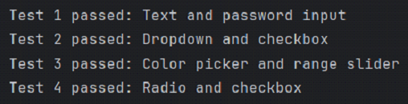

# 🧪 Selenium Web Form Automation

> An automated UI testing suite built with Python and Selenium WebDriver. Developed as Lab 3 for the "Methods of Software Specification and Verification" course at Taras Shevchenko National University of Kyiv.

---

## 🛠️ Tech Stack & Tools
- **Language:** Python 3
- **Automation Framework:** Selenium WebDriver
- **Browser Automation:** Google Chrome (ChromeDriver)
- **Core Concepts:** Automated UI Testing, DOM Element Locators (XPath, ID, Name, Tag), Explicit Waits (`WebDriverWait`, `expected_conditions`).

---

## ⚙️ Test Suite Overview

The script executes a suite of automated interactions against the official Selenium test form (`https://www.selenium.dev/selenium/web/web-form.html`) to verify UI components and form submission logic.

### Executed Scenarios
1. **Text & Password Inputs:** Locates and fills standard text fields and secure password inputs using `By.NAME`.
2. **Dropdowns & Checkboxes:** Tests `<select>` element interaction using precise XPath matching and verifies checkbox selection states.
3. **Custom Inputs (Color & Range):** Automates interactions with non-standard input types like color pickers (`#ff0000`) and range sliders.
4. **Radio Buttons:** Validates mutually exclusive selection logic in radio groups using `By.ID`.

*All tests implement `WebDriverWait` to explicitly wait for the "Form submitted" `<h1>` confirmation tag before passing.*

---

## 📸 Testing and Execution Result

Below is the console output showing all four test scenarios passing successfully:

